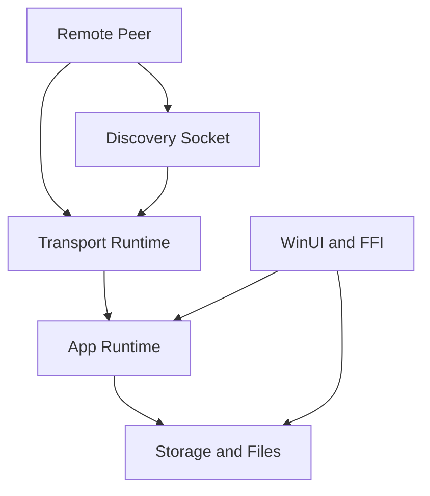

# Security Audit and Threat Model for `omni`

## Executive summary

Current LAN hardening has closed the previously identified `VerificationChallenge` auto-approve path, the attachment-control `Approved` gap, and the broad active-connection `SessionHello` admission rule. The remaining security work is mostly resource-control and policy depth: discovery is still an unauthenticated hint plane by design, some non-attachment metadata events still need explicit relationship-state review, and global quotas for temp/download churn are still limited.

## Scope and assumptions

- In-scope paths:
  - `core-rust/crates/omni-app/src`
  - `core-rust/crates/omni-transport/src`
  - `core-rust/crates/omni-protocol/src`
  - `core-rust/crates/omni-storage/src`
  - `core-rust/crates/omni-ffi/src`
  - `windows-app/src/Omni.Windows.App/Core`
  - `README.md`
  - `ARCHITECTURE.md`
  - `docs/architecture/overview.md`
- Out of scope:
  - external infrastructure, relay/STUN/TURN, and real runtime configs outside the repository
  - CI/CD as a separate attack target
  - the cryptographic strength of the underlying primitives as such
- Assumptions:
  - the application is a Windows-first 1:1 p2p messenger with no central trust authority, where discovery must not be a source of trust
  - the hostile actor is either a malicious peer on the same network / with the same transport reachability, or a peer that has already established a session but is not yet an approved contact
  - local file operations are treated as a local trust boundary, not a remote network vulnerability
  - the assessment is based on the repository code
- Open questions that would materially change priority:
  - whether the product allows non-LAN and internet-exposed peerings by default
  - how unpredictable message IDs are and whether they can be learned through other side channels
  - who exactly initiates the backup/download paths in the UI and whether there is additional validation at the shell/UI level

## System model

### Primary components

- `omni-transport`: libp2p transport, discovery, admission, quarantine, request/response, attachment-transfer stream.
- `omni-app`: session bootstrap, wire dispatch, contact lifecycle, verification, logical events, attachment pipeline.
- `omni-storage`: SQLite-backed contact/session/message/attachment state and local filesystem operations.
- `omni-protocol`: wire schema validation, payload size budgets, protocol invariants.
- `omni-ffi` + WinUI shell: JSON FFI boundary and desktop UI bridge.

### Data flows and trust boundaries

- LAN / peer network -> discovery socket
  - Data: discovery announcements, alias/account hints, listener endpoints
  - Channel: UDP multicast / broadcast / loopback / explicit targets
  - Security guarantees: packet size cap, source filtering, registry cap, quarantine metadata
  - Validation: JSON parse + basic field checks, but no authenticity proof
- Remote peer -> libp2p transport session
  - Data: `SessionHello`, `SessionBootstrap`, encrypted wire envelopes, attachment transfer frames
  - Channel: libp2p TCP/TLS/QUIC/WebSocket + request/response streams
  - Security guarantees: protocol validation, concurrency caps, request queue caps, quarantine, session crypto
  - Validation: `validate_session_hello_v1`, `validate_wire_envelope_v1`, attachment frame limits
- Encrypted application payload -> `omni-app`
  - Data: chat, receipts, verification payloads, profile sync, attachment control events
  - Channel: decrypted wire envelope dispatch
  - Security guarantees: session bootstrap state and `Approved` checks on chat, attachment offer, and attachment control paths
  - Validation: pending peers remain limited to bootstrap/request/presence flows needed for onboarding
- `omni-app` -> `omni-storage`
  - Data: contacts, sessions, message metadata, temp files, backup import/export paths
  - Channel: in-process Rust calls + filesystem
  - Security guarantees: mostly logical invariants and hash/size checks
  - Validation: caller-provided paths are accepted with limited confinement
- WinUI / FFI -> Rust core
  - Data: JSON requests, file paths, config
  - Channel: C ABI + JSON serialization
  - Security guarantees: panic containment via `catch_unwind`, UTF-8 checking
  - Validation: semantic path safety depends on the caller

#### Diagram

## Assets and security objectives

| Asset | Why it matters | Security objective (C/I/A) |
|---|---|---|
| Contact approval state | Determines who can become a regular conversation partner | I |
| Session binding (`dialog_key`, remote account/device) | An error in the binding breaks the trust model and routing | I |
| Local attachments / blobs | May contain sensitive user files | C/I |
| Local database and backup bundle | Holds history, contacts, key runtime state | C/I/A |
| Identity / verification payloads | Tampering breaks trust onboarding | I |
| Discovery registry and peer metadata | Affects routing, UX and transport load | A/I |
| Temp download files / profile media | Can cause disk churn and local degradation | A |

## Attacker model

### Capabilities

- Can send discovery packets on the same L2/LAN or to an explicit discovery target.
- Can establish a libp2p session and send validly formed wire/logical payloads.
- Can be non-`Approved` but already a session-capable peer.
- Can spam attachment frames, receipts, profile sync and bootstrap/control events.
- In a local scenario, can supply an unsafe path through the UI/FFI/integration layer.

### Non-capabilities

- Arbitrary code execution on the victim's machine through the considered paths alone is not assumed.
- Breaking cryptography or forging identity signatures without key compromise is not assumed.
- Arbitrary reading of other files without knowing or reaching the corresponding local API path surface is not assumed.

## Entry points and attack surfaces

| Surface | How reached | Trust boundary | Notes | Evidence (repo path / symbol) |
|---|---|---|---|---|
| Discovery announcements | UDP packet to discovery port | Peer -> discovery runtime | JSON hint plane, not authenticated | `core-rust/crates/omni-transport/src/libp2p_discovery.rs` / `process_discovery_packet_v2` |
| Session hello admission | libp2p request-response | Peer -> transport runtime | Admission is limited to the active peer, already verified peer, pending connect, or idle activation path | `core-rust/crates/omni-transport/src/libp2p_runtime.rs` / `session_hello_admission_open` |
| Session bootstrap | Encrypted wire payload | Peer -> app runtime | Auto-creates pending contacts for unknown initiators | `core-rust/crates/omni-app/src/runtime_transport_events.rs` / `WirePayloadV1::SessionBootstrap` |
| Verification challenge | Encrypted wire payload | Peer -> app runtime | Incoming handler fail-closes for non-`Approved` contacts | `core-rust/crates/omni-app/src/runtime_transport_events.rs` / `handle_incoming_verification_challenge` |
| Attachment download request | Logical event | Peer -> app runtime -> file serving | Attachment control events require an `Approved` dialog contact before serving or mutating metadata | `core-rust/crates/omni-app/src/runtime_transport_events.rs` / `attachment_control_event_allowed` |
| Attachment chunks / completion | Logical events + stream frames | Peer -> app runtime -> temp file | Good per-transfer checks, no obvious global quota | `core-rust/crates/omni-app/src/runtime_transport_events.rs` / `persist_attachment_chunk` |
| Public profile sync | Logical event | Peer -> app runtime -> storage | Applies remote profile data without approval gate at dispatch | `core-rust/crates/omni-app/src/runtime_transport_events.rs` / `persist_public_profile_descriptor_sync` |
| Backup import/reset/download save paths | WinUI/FFI request | Local caller -> storage/filesystem | Accepts caller-controlled paths with destructive file ops | `core-rust/crates/omni-app/src/lib.rs` / `import_database_backup_bundle` |

## Top abuse paths

1. Forget / re-request stale session race
   1. an existing transport connection survives a local `forget`
   2. stale encrypted events from the old ratchet race with the new bootstrap
   3. receiver must ignore stale non-`Approved` encrypted payloads without processing them
   4. fresh request approval must establish a new session before chat resumes

2. Session-only attachment resend
   1. attacker establishes a session but remains non-approved
   2. attacker sends `AttachmentDownloadRequest` for a valid `message_id`
   3. receive-side gate must reject it before metadata or file-serving paths run
   4. regression coverage should keep this path closed for all attachment control events

3. Discovery spoof / registry pollution
   1. attacker floods UDP discovery with rotating announce IDs / aliases / endpoints
   2. registry observes and keeps up to the live cap
   3. UI/routing sees polluted candidates or misleading endpoints
   4. result is degraded UX, routing noise, or connect-to-wrong-endpoint pressure

4. Metadata poisoning through non-attachment control events
   1. attacker gets session without approval
   2. attacker sends receipts or profile sync payloads
   3. storage updates delivery/attachment/profile metadata
   4. result is false state, noisy auditing, or user-visible inconsistency

5. Attachment temp-file churn
   1. attacker triggers repeated transfers / chunks / restarts
   2. receiver creates temp files and checkpoints progress
   3. per-transfer limits hold, but global churn accumulates
   4. result is disk I/O pressure, temp-file buildup, and degraded responsiveness

6. Admission widening through session hello
   1. victim already has an active connection
   2. unrelated peer sends `SessionHello`
   3. admission helper must reject it unless it matches an active/verified/pending/idle path
   4. runtime must not accept more verified session state than intended

7. Local destructive path misuse
   1. caller supplies unexpected DB/download/export path
   2. storage import/reset/delete logic uses that path directly
   3. files or directories outside intended app area are copied over or deleted
   4. result is local data loss or accidental overwrite

## Threat model table

| Threat ID | Threat source | Prerequisites | Threat action | Impact | Impacted assets | Existing controls (evidence) | Gaps | Recommended mitigations | Detection ideas | Likelihood | Impact severity | Priority |
|---|---|---|---|---|---|---|---|---|---|---|---|---|
| TM-001 | Session-capable malicious peer | Must reach an encrypted session/bootstrap and not be `Declined` | Sends an incoming `VerificationChallenge` to a non-`Approved` contact | Attempt to bypass the trust/onboarding model | Contact approval state, session binding | Incoming and outgoing challenge paths require `Approved`; response path fail-closes for non-approved contact | Keep regression coverage and telemetry honest | Maintain non-approved challenge tests; count unexpected challenge attempts by relationship state | Audit log / metric on challenge for non-approved contact; alert on contact state changes caused by challenge handler | Medium | High | medium |
| TM-002 | Session-capable malicious peer | Needs a session and knowledge of a valid `message_id`; attachment locally serveable | Sends `AttachmentDownloadRequest` without `Approved` and tries to initiate a transfer path | Unauthorized attachment delivery or dialog binding confusion | Local attachments, session binding | Attachment offer and attachment control events are gated for approved contacts; local-serving flag and blob checks exist | Keep dialog/message binding and quota work under review | Maintain the `pending_contact_attachment_control_events_are_ignored` regression; add per-peer transfer quotas | Metric/log on attachment download requests from non-approved contacts; count resend failures by relationship state | Low | High | medium |
| TM-003 | Malicious peer on same network | Discovery reachable on LAN / explicit target | Spoofs discovery announcements and pollutes the candidate registry | UX/routing degradation, possible misdirection | Discovery registry, availability | Packet cap 4096 B, registry cap 256, quarantine threshold 3, hint-plane docs | No authenticity on discovery packet content | Sign or MAC discovery payloads where possible, or strictly downgrade all discovery metadata in UI/routing; add stronger anti-replay / per-source rate limits | Metrics on discovery cardinality, alias/account churn, per-source announce rate | High | Medium | medium |
| TM-004 | Session-capable malicious peer | Has session, not necessarily approved | Sends receipts / profile sync / route hints to mutate local metadata or peer-hints discovery state | False message state, noisy DB churn, user confusion, possible future misdirection via poisoned hints | Message metadata, profile state, peer hints, auditability | Receipts and public-profile syncs already gated to Approved via `dialog_contact_is_approved_for_logical_events`. **RouteHintsSync is now gated to Approved in `persist_route_hints_sync` (TM-004 fix, see `docs/decisions/tm-004-metadata-poisoning-fix.md`)** with regression test `tm004_route_hints_sync_is_gated_on_approved_contact_state`. Chat/attachment event classes were already approval-gated. Verification challenges and challenge responses are signature-validated. | Contact-presence-ping pending-contact creation falls under TM-008 spam scope, not TM-004 | (mitigated) Future: count logical events by relationship state in telemetry | Drops emit `tm004/route_hints/drop` trace events when the `OMNI_TRACE_FILE` env var is set | Medium | Medium | mitigated |
| TM-005 | Session-capable malicious peer | Can repeatedly trigger transfer workflow | Floods attachment frames/restarts causing temp-file and disk churn | Availability degradation, disk pressure | Temp files, storage I/O, app responsiveness | Per-transfer reorder cap 8 MiB, stream frame size caps, request concurrency 4, queue 64, file/hash checks. **Per-dialog quota=8 active inbound transfers**, **global temp-bytes budget=512 MiB**, **stale-transfer GC at 24h TTL** (see `docs/decisions/attachment-transfer-quotas.md`) | None remaining. Future: configurable limits via FFI, per-account counters, adaptive sizing by free disk space | (mitigated) Monitor temp download dir size, active transfer count, repeated failed transfer IDs, attachment GC counter | Medium | Medium | mitigated |
| TM-006 | Malicious or unexpected local caller | Can invoke backup/download/reset APIs through UI/FFI or future integration | Supplies arbitrary filesystem paths to delete/copy operations | Local data loss / overwrite | Local database, filesystem | Foundation helper `confine_destructive_path` (canonicalize + Windows/*nix system-directory blocklist + drive-root rejection + absolute-path requirement) in `omni-storage/src/lib.rs:128`. Sites covered: `Storage::delete_local_data_at_path`, `Storage::save_attachment_copy_to_path`, `Storage::export_database_backup`, `omni-app::export_backup_bundle_contents`, `omni-app::request_attachment_download`. Regression tests at storage layer (`tm006_confine_*`, 4 cases including Windows system paths, drive roots, relative paths, positive temp-dir) and app layer (`tm006_export_database_backup_rejects_system_path`, `tm006_request_attachment_download_rejects_system_save_path`). See `docs/decisions/path-confinement-tm006.md` (foundation) and `docs/decisions/tm-006-destructive-path-confinement.md` (follow-up, closes the last three open sites). | (mitigated) Future: structured logging for destructive path ops with canonical target (TraceLog hookup TBD) | (mitigated) Monitor for `OmniError::InvalidInput("destructive path is in a protected system directory: …")` in error telemetry | Medium | Medium | mitigated |
| TM-007 | Session-capable malicious peer | Victim already has an active connection | Sends unsolicited `SessionHello` while active connection exists | Admission broadening, extra verified session churn | Session binding, availability | Admission now allows only same peer, verified peer, pending connect, or explicit idle activation; regression covers unrelated active-session attempts | Continue monitoring reconnect and discovery-assisted flows | Keep the narrow admission helper tests and avoid reintroducing active-connection wildcard admission | Count admitted session hellos by reason; alert on accepted hello from unexpected peer | Low | Medium | low |
| TM-008 | Session-capable malicious peer | Can reach bootstrap/session or presence ping paths | Creates large numbers of pending contacts/observations | Contact list clutter, storage churn, operator confusion | Contact state, availability | Declined contacts ignored; approved contacts get special handling; storage `add_pending_contact` is idempotent on `remote_account_id` so a single peer can't double-row; **`upsert_transport_pending_contact` gates NEW (no pre-existing) pending-creations through a per-profile sliding-window rate limit: 32 new entries per 60 minutes, beyond which the call silently drops** with a `tm008/pending/drop` trace (see `docs/decisions/tm-008-pending-contact-rate-limit.md`). User-initiated outgoing pendings (`add_outgoing_pending_contact` from signaling paste) bypass the limit by design. Regression tests: `tm008_rate_limit_admits_under_threshold`, `tm008_rate_limit_drops_at_threshold`, `tm008_rate_limit_recovers_after_window`, `tm008_rate_limit_is_per_profile`. | (mitigated) Future: quarantine contact-spam patterns (UI surface beyond rate limit), per-source dedupe by network identity | Drops emit `tm008/pending/drop` traces when `OMNI_TRACE_FILE` is set; rate-limit deque size visible via static registry inspection | Medium | Low | mitigated |

## Bootstrap & community-node threats (design-stage, TM-009..017)

These cover the **cross-network bootstrap / rendezvous / community-volunteer-node** design (not yet
implemented). Detail and the per-threat defenses live in `docs/decisions/serverless-bootstrap-rendezvous.md`
and `docs/decisions/community-volunteer-nodes.md`. **Unifying invariant:** trust is identity-bound (the
mutual connect-time challenge); every third-party service, the rendezvous **helper process**, and every
volunteer node are *untrusted couriers* of opaque (E2E + signed) blobs under blinded topics, so they can
**DoS or observe metadata, never deceive**. Defenses are deliberately *cheap* (asymmetric crypto-gating +
structural gating + bounded/TTL/backoff), with no PoW and no Tor by default (battery/latency), and **no
tokens**.

| Threat ID | Source / setting | Threat action | Impact | Key defenses (cheap) | Priority |
|---|---|---|---|---|---|
| TM-009 rendezvous poisoning | any third-party rendezvous (Nostr/DHT/ntfy) or the helper | forge/replay a beacon → point a peer at a wrong/attacker endpoint | one wasted dial (not deception) | signed + TTL + nonce beacon; **connect-time challenge** rejects the wrong peer; dedup window | low |
| TM-010 eclipse / provider outage | adversary controls or degrades your rendezvous channels, or a provider is unavailable | isolate a peer from all rendezvous | availability loss | **N-of-many** independent providers; **per-component proxy** (route just the helper via Tor/VPN); mutual-contact rendezvous (in-mesh) | medium |
| TM-011 bootstrap amplification / DoS | malicious peer / open internet | flood your topic; turn you into a reflector | resource/CPU/battery drain | **blinded per-pair topics ⇒ only contacts can reach you**; cheap-verify-before-act; 1-byte probes; anti-amplification dial-back; bounded queues/TTL | medium |
| TM-012 first-contact impersonation | active MITM at the very first key exchange | impersonate a contact during pairing | wrong identity trusted | **irreducible:** out-of-band safety-number / QR verification; loud key-change warning; rendezvous can deliver an invite but never vouches | medium |
| TM-013 helper-process compromise | exploit via hostile bytes from a third-party service | RCE in the untrusted-facing helper | contained: no keys, sandboxed, core unreachable | **privilege separation** (helper holds no keys, sandbox, separate process over omni-daemon IPC) ⇒ degrades to “a malicious courier” = DoS only | medium |
| TM-014 open-relay abuse / DoS | strangers (open volunteer tier) | flood/exhaust an open node’s bandwidth/storage | operator resource drain | per-source fairness (IP+identity) + **local reputation** (not whitelist) + bounded/TTL + **graceful load-shed** (drop open tier first) + content-blind; no-PoW-by-default | medium |
| TM-015 Sybil open-nodes | adversary runs many fake public nodes | attract traffic → observe metadata / selectively drop | metadata exposure, availability | **N-of-many** + **trust-gradient routing** (prefer friend nodes) + health/reputation scoring + identity-bound (can’t deceive) + privacy dial (Tor) | medium |
| TM-016 operator exposure to abuse reports | running an open relay | carry strangers’ (encrypted) traffic → abuse complaints against the operator | operator risk | **content-blind** (can’t see/curate content, like a Tor relay); default **OFF**; informed-consent UX; rendezvous-only low-risk default; easy scope-down + caps | medium |
| TM-017 metadata-to-strangers | open volunteer nodes | see endpoints/timing of strangers’ connections they carry | metadata leak to untrusted operators | **trust-gradient routing** (open = last resort) + **friends-only** privacy cap + **time-bucketed topic rotation** + timing jitter + optional Tor for the helper | medium |

No-privileged-node invariant carried by the community model: **the app must function with an EMPTY
bootstrap list**; no shipped/maintainer node is privileged or required; registries, nodes and providers are
all N-of-many and user-addable/removable.

## Group-call cascade: active-speaker activity leak (C1, accepted)

The cascade peer-SFU (`docs/decisions/group-call-cascade-sfu.md`) gates media at forwarders by a **cleartext
`media_meta` byte** the sender stamps on every media datagram: high bit = is_video, low 7 bits = a coarse
audio-activity level. A forwarder is a mesh peer that carries the call's frames and **may not be a member of
the group**. So `media_meta` reveals to that forwarder **who is speaking + rough loudness** (the low bits) and
**who has video on** (the high bit), per sender, in the clear.

- **Why accepted:** the forwarder already sees the *timing and size* of each sender's datagrams (it routes
  them), so it can already infer the active speaker from traffic shape; the byte is a marginal additional leak,
  not a new capability. Call **content stays E2EE** (the sealed body is never touched; forwarders hold no
  SFrame keys). The alternative, members deciding the active speaker over the control plane and signalling it,
  adds switching lag and its own metadata, and was rejected. This is the price of active-speaker scale
  (bounding per-receiver downlink to ~K streams so **video** scales past the tree's uplink-only fix).
- **Residual / bound:** only *activity + media-kind* leaks, never identity beyond the routing pseudonym
  (`sender_tag`) the forwarder must already resolve to relay. Forwarders are call participants selected by the
  deterministic tree (rank = uplink/willingness), overlapping the trust-gradient routing preference for
  friend nodes (cf. TM-017). Not mitigated further in v1; to be revisited if untrusted open-tier nodes ever carry
  group-call media.

## Criticality calibration

- `critical`
  - a remote path to arbitrary code execution on the client
  - reading or deleting arbitrary local data by a remote peer without strong preconditions
  - a mass trust bypass that automatically turns a stranger into a trusted peer by default
- `high`
  - bypass of the user-approval / trust model for an individual peer
  - unauthorized attachment delivery under reachable preconditions
  - gross violation of session/contact binding that changes the actual recipient/trust
- `medium`
  - DoS or state poisoning without full compromise
  - discovery spoofing / peer pollution / metadata churn
  - locally dangerous path operations if abused by the UI/integration layer
- `low`
  - noisy pending-contact spam scenarios
  - events that break UX but do not compromise anything
  - problems requiring rare or hard-to-reach preconditions

## Focus paths for security review

| Path | Why it matters | Related Threat IDs |
|---|---|---|
| `core-rust/crates/omni-app/src/runtime_transport_events.rs` | Bootstrap, verification, logical events, attachment receive paths and most trust bugs converge here | TM-001, TM-002, TM-004, TM-005, TM-008 |
| `core-rust/crates/omni-transport/src/libp2p_runtime.rs` | Admission logic for `SessionHello`, request-response limits, session lifecycle | TM-007 |
| `core-rust/crates/omni-transport/src/libp2p_discovery.rs` | Unauthenticated discovery ingress, endpoint hints, candidate registry | TM-003 |
| `core-rust/crates/omni-transport/src/lib.rs` | Peer trust hints, quarantine, violation accounting, intro session limits | TM-003, TM-007, TM-008 |
| `core-rust/crates/omni-app/src/runtime_queue.rs` | Outbound attachment transfer path, actual file serving, dialog binding | TM-002, TM-005 |
| `core-rust/crates/omni-storage/src/storage_attachments.rs` | Save paths, temp-file handling, local blob/export logic | TM-002, TM-005, TM-006 |
| `core-rust/crates/omni-storage/src/lib.rs` | Destructive local-data delete helpers derived from a caller-supplied DB path | TM-006 |
| `core-rust/crates/omni-app/src/lib.rs` | Backup import/export entrypoints and delete-before-copy flow | TM-006 |
| `core-rust/crates/omni-protocol/src/lib.rs` | Payload validation budgets and the baseline protections already in place | TM-003, TM-005, TM-007 |
| `windows-app/src/Omni.Windows.App/Core/RustBridge.cs` | UI/FFI path surface into destructive and filesystem-sensitive core operations | TM-006 |
| `README.md` | Documents the intended invariants: approved-only chat, discovery as hint plane, quarantine, soft-fail budgets | TM-001, TM-003, TM-007 |
| `ARCHITECTURE.md` | Records the security model and especially the invariant on unsolicited early session traffic | TM-001, TM-007 |
